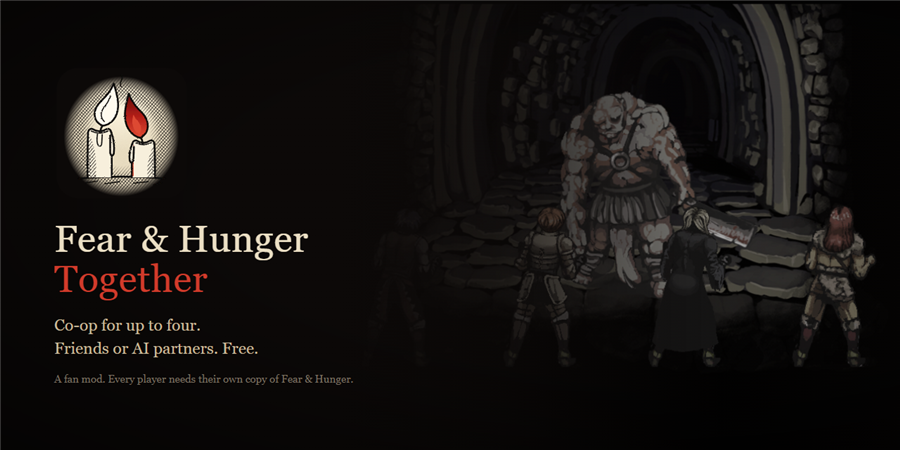
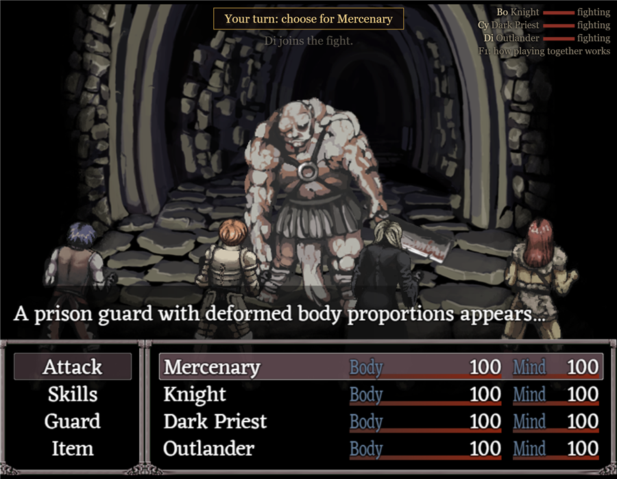
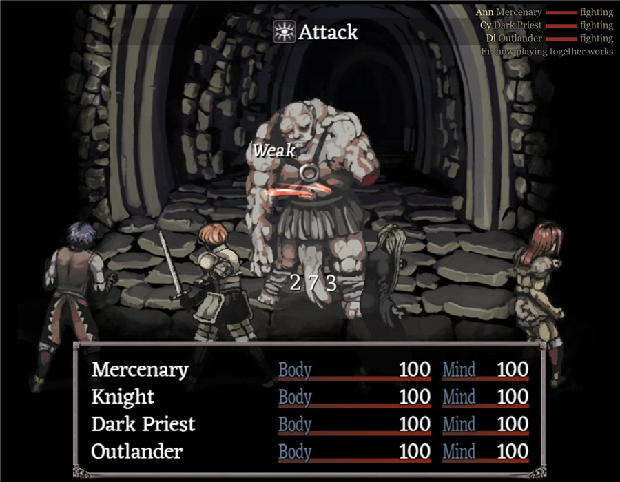
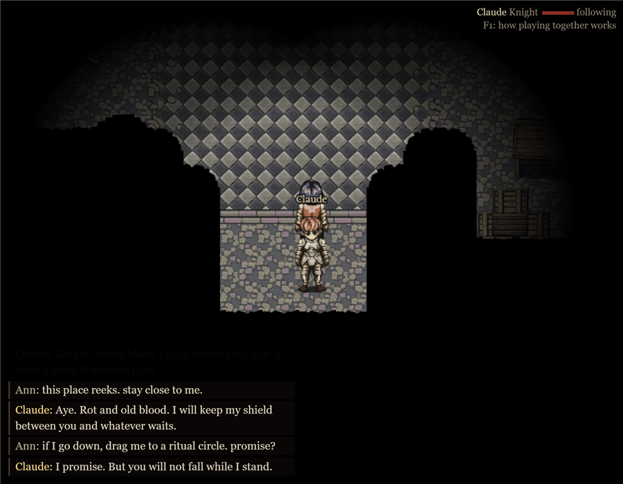
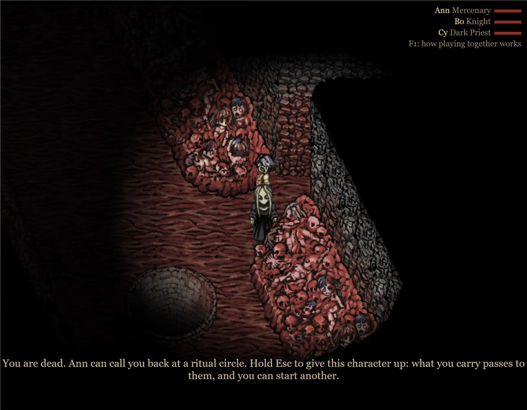
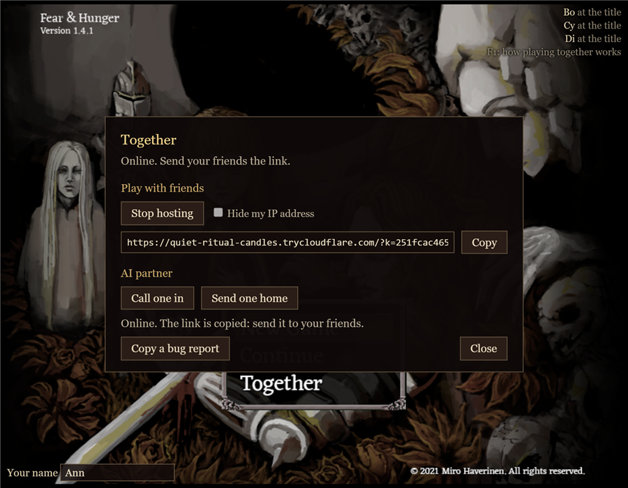
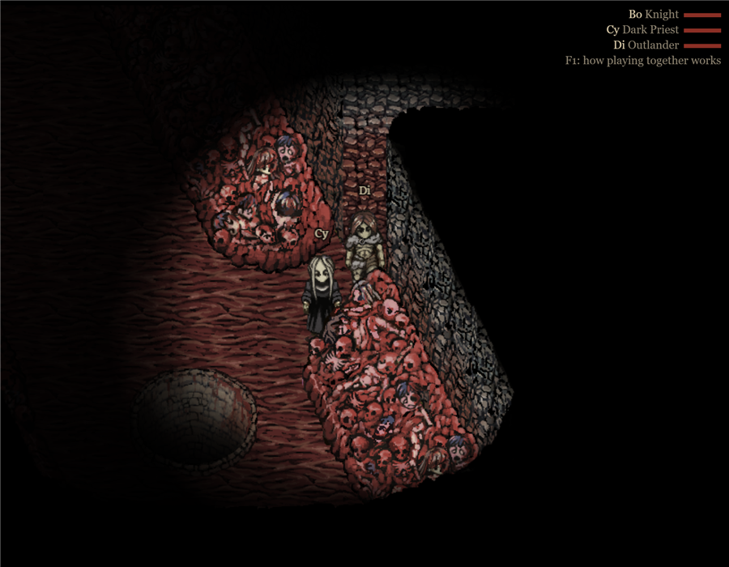

# Fear & Hunger Together

Co-op for **Fear & Hunger** (the first game). Up to four players share one dungeon as separate characters: split up or stick together, fight side by side, and drag each other back from death at the ritual circles. Play with friends, with AI partners, or both.

Free, and a fan mod: not made or endorsed by Miro Haverinen. None of the game's files are included: every player plays from their own copy (Steam or itch), and nothing in the game's folder is changed. The screenshots show Fear & Hunger, which belongs to Miro Haverinen.

Made with Claude, Anthropic's AI: the code, the text and the icon. The AI partner writes its own lines while you play.

**[Download the latest release](https://github.com/glynn568-glitch/fear-and-hunger-together/releases/latest)**, unzip it, and double-click **Fear & Hunger Together**.

## What it looks like

| | |
|---|---|
|  |  |
| **One fight, everyone in it.** Whoever touches the enemy starts it; anyone nearby is pulled in, and each player commands their own character. | **The same fight on a friend's PC**, live. |
|  |  |
| **An AI partner** plays a character by the same rules you do: it fights its own turns, eats, binds its wounds, takes orders, and talks in character. Unedited exchange. | **Death isn't the end of the run.** You watch through a living partner's eyes until they call you back at a ritual circle. |
|  |  |
| **Host online from the title screen.** Hosting gives you a link to send; a friend clicks it, their game opens and offers to join. | Four characters between all of you, as in the game. |

## How it holds together

- Nothing in the game's folder is touched, and no other mod loader is needed.
- Friends connect through a private link with a key in it, and can hide everyone's IP address.
- One world: the dungeon's dice are thrown once, doors and switches agree on every machine, and two automated players have walked every map to check it.
- A shared fight is one fight, run on one machine and shown live to the others.
- Everyone's game and mod versions are checked on joining, with a plain message if they differ.
- 32 automated test scenarios, including the softlocks players have hit in co-op before (coin flips, falling, the Nosramus scene, extra turns).

The full player guide is in [README.md](../README.md).

## Bugs

Press **Ctrl+Shift+B** in the game (or **Copy a bug report** in the Together panel) and paste what it copies into a [new issue](https://github.com/glynn568-glitch/fear-and-hunger-together/issues/new/choose). It holds the versions, the end of your logs and what the game was doing, with link keys and your Windows user name left out.

## Contributing

Forks are welcome, and so are bug reports. Pull requests aren't accepted.

## For tinkerers

Node.js server, the game's own RPG Maker engine in Edge or Chrome, and a small C# launcher. `npm test` runs the suite with headless Chrome. The [player README](../README.md) has the rest.

MIT licensed. Fear & Hunger and everything in it belong to Miro Haverinen.

Code signing: the launcher is being set up for free code signing provided by SignPath.io, certificate by SignPath Foundation. Until that is approved, releases are unsigned. [Code signing policy](../docs/code-signing.md).
